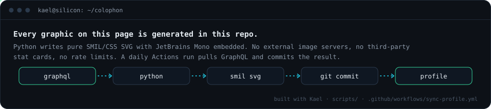

<a href="https://github.com/whatever0148-cmd">github</a> · <a href="mailto:f2026376047@umt.edu.pk">f2026376047@umt.edu.pk</a> · <a href="https://github.com/whatever0148-cmd/SonarANE">SonarANE</a>

